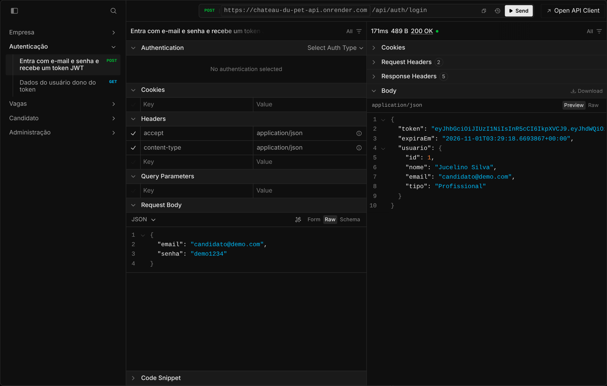
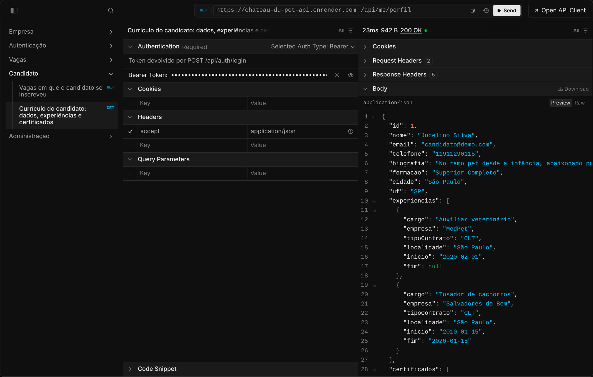

# 🐾 Chateau Du Pet: app mobile e desktop

App de vagas de emprego do mundo pet, reescrito em **.NET MAUI** a partir do app original em Xamarin.Forms (TCC, 2021). O mesmo código roda no **Android** e no **Windows**, e substitui também o antigo app desktop de gestão.

Este repositório traz o app e a **API** que ele consome. A API usa o mesmo banco PostgreSQL da [versão web em .NET 8](https://github.com/offryan/CHATEAU-DU-PET), então o que é feito no app aparece no portal e vice-versa.

🔗 **API no ar:** https://chateau-du-pet-api.onrender.com/scalar ([teste em 2 minutos](#-teste-a-api-em-2-minutos))

## 📱 O app em funcionamento

Gravação do APK rodando num celular Android, consumindo a API publicada:

https://github.com/user-attachments/assets/f57e9775-f1a2-4dfa-a64c-0eb34ffdba9b

📥 **Baixe e instale:** [chateau-du-pet.apk](https://github.com/offryan/chateau-du-pet-mobile/releases/latest/download/chateau-du-pet.apk) (Android 6.0 ou mais recente; veja todas as versões em [Releases](https://github.com/offryan/chateau-du-pet-mobile/releases))

> O APK não vem da Play Store, então o Android pede para permitir a instalação de fontes desconhecidas e o Play Protect pode mostrar "app não verificado". Toque em **Instalar mesmo assim**.

💻 **Windows:** [chateau-du-pet-windows.zip](https://github.com/offryan/chateau-du-pet-mobile/releases/latest/download/chateau-du-pet-windows.zip) (Windows 10 ou 11, 64 bits). Não precisa instalar: extraia o zip e abra o **Chateau Du Pet.exe**, que fica na pasta extraída ao lado de um `LEIA-ME.txt` (os arquivos do app ficam guardados na subpasta `app`).

> Como o app não é assinado, o Windows pode mostrar "O Windows protegeu o computador". Clique em **Mais informações → Executar assim mesmo**.

## ✨ O que o app faz

| Perfil | Funcionalidades |
|---|---|
| **Visitante** | Lista e busca vagas (por cargo, empresa ou cidade), vê os detalhes e compartilha |
| **Profissional** | Tudo do visitante + se candidata e cancela candidaturas, acompanha as candidaturas e vê o próprio currículo (experiências e certificados) |
| **Empresa** | Publica, edita e exclui vagas; vê os candidatos de cada vaga e o currículo completo de cada um, com atalhos para e-mail e telefone |
| **Administrador** | Painel com profissionais, empresas e vagas: busca, vê currículos e exclui cadastros (as vagas e candidaturas ligadas saem junto) |

Detalhes que fazem diferença no uso:

- Login salvo com segurança no aparelho (Keystore no Android, Keychain no iOS) até o token vencer
- Puxar para atualizar, estados de carregando/vazio/erro com "tentar de novo"
- Busca enquanto digita, sem chamar a API a cada letra
- Tema claro e escuro, seguindo o aparelho
- No Windows, as telas ficam centralizadas com largura confortável em vez de esticar pela janela inteira
- A API gratuita do Render "dorme" quando fica parada; o app espera até ela acordar, tenta de novo sozinho e avisa o usuário se demorar

### Contas de demonstração

Senha de todas: `demo1234` (os dados são fictícios e voltam ao original todo dia)

| Perfil | E-mail |
|---|---|
| Profissional | `jucelino@exemplo.com` |
| Empresa | `felipe@exemplo.com` |
| Administrador | `admin@exemplo.com` |

## 🧪 Teste a API em 2 minutos

Dá para ver a API funcionando direto no navegador, sem instalar nada, pela documentação interativa (Scalar).

> A API está no plano gratuito do Render, que "dorme" quando fica parada: o primeiro acesso pode levar até 1 minuto.

**1. Abra a documentação:** https://chateau-du-pet-api.onrender.com/scalar

**2. Faça login.** No menu à esquerda, abra **Autenticação → Entra com e-mail e senha** e clique em **Test Request**. O corpo já vem preenchido com a conta de demonstração do profissional; é só clicar em **Send**. A resposta traz o `token`, a validade e os dados do usuário.



**3. Copie o `token`** da resposta (sem as aspas).

**4. Veja o currículo.** Abra **Profissional → Currículo do profissional**, clique em **Test Request**, escolha **Bearer** em *Authentication*, cole o token e clique em **Send**. Voltam os dados, as experiências e os certificados do profissional.



**Outras coisas para testar:**

| O que fazer | Rota | Precisa de token? |
|---|---|---|
| Listar todas as vagas | `GET /api/vagas` | Não |
| Buscar vagas (ex.: `busca=veterin`) | `GET /api/vagas?busca=veterin` | Não |
| Ver uma vaga e se você já se candidatou | `GET /api/vagas/2` | Opcional |
| Se candidatar (e depois cancelar) | `POST` e `DELETE /api/vagas/2/candidatura` | Sim, de profissional |
| Ver as próprias candidaturas | `GET /api/me/candidaturas` | Sim, de profissional |
| Ver as vagas da empresa e os candidatos | `GET /api/me/vagas` e `/api/me/vagas/1/candidatos` | Sim, de empresa (`felipe@exemplo.com`) |
| Publicar uma vaga | `POST /api/me/vagas` | Sim, de empresa |
| Listar profissionais e empresas | `GET /api/admin/profissionais` e `/api/admin/empresas` | Sim, de administrador (`admin@exemplo.com`) |

Repare nas regras de acesso: com o token de profissional, as rotas de empresa e de administrador respondem `403`; uma empresa que tenta editar a vaga de outra recebe `404`; sem token, as rotas protegidas respondem `401`; candidatar-se duas vezes à mesma vaga responde `409` com a mensagem "Você já se candidatou a esta vaga."

## 🔄 Do Xamarin para o .NET MAUI

O app de 2021 era o template do Xamarin.Forms com dados fictícios fixos no código (`MockDataStore`) e não falava com o banco. A nova versão foi escrita do zero:

| | Versão 2021 | Versão atual |
|---|---|---|
| Framework | Xamarin.Forms 5 (suporte encerrado em maio/2024) | .NET MAUI 10 (.NET 10 LTS) |
| Projetos | Um projeto compartilhado + um por plataforma | Projeto único com `Platforms/` |
| Dados | Lista fixa em memória | API REST com dados reais do banco |
| MVVM | `INotifyPropertyChanged` escrito à mão | CommunityToolkit.Mvvm (`[ObservableProperty]`, `[RelayCommand]`) |
| Injeção de dependência | `DependencyService` | `Microsoft.Extensions.DependencyInjection` |
| Bindings | Resolvidos em tempo de execução | Compilados (`x:DataType`) e XAML gerado em C# na compilação |
| HTTP | — | `IHttpClientFactory` + Polly (novas tentativas e timeouts) |
| JSON | — | `System.Text.Json` com geração de código (sem reflexão, compatível com trimming) |
| Testes | Nenhum | 125 testes automatizados |
| Android alvo | API 30 | API 36 |

## 🧱 Arquitetura

```
┌──────────────────────┐      HTTPS + JWT      ┌─────────────────────┐      ┌──────────────┐
│  App .NET MAUI       │ ────────────────────▶ │  API ASP.NET Core   │ ───▶ │  PostgreSQL  │
│  (Android / Windows) │ ◀──────────────────── │  (Minimal API)      │      │  (Supabase)  │
└──────────────────────┘        JSON           └─────────────────────┘      └──────────────┘
                                                                                   ▲
                                                 Portal web .NET 8 (outro repo) ───┘
```

```
src/
├── ChateauDuPet.Contracts   → records trocados entre API e app (um campo renomeado quebra a compilação dos dois lados)
├── ChateauDuPet.Api         → ASP.NET Core 10 Minimal API: JWT, Dapper + Npgsql, OpenAPI + Scalar
├── ChateauDuPet.App.Core    → ViewModels, cliente da API e sessão, sem dependência de MAUI (testável com xUnit comum)
└── ChateauDuPet.App         → .NET MAUI: telas XAML, tema, Shell e implementações de plataforma
tests/
├── ChateauDuPet.Api.Tests       → integração: API em memória contra PostgreSQL real
└── ChateauDuPet.App.Core.Tests  → ViewModels, sessão e cliente HTTP
database/                    → schema.sql e seed.sql (os mesmos do portal web) e api-permissoes.sql
```

A lógica do app fica em `App.Core`, que conversa com a plataforma por interfaces pequenas (`INavegacao`, `IPlataforma`, `IArmazenamentoSeguro`). O projeto MAUI só implementa essas interfaces e desenha as telas; os testes usam versões falsas delas.

## 🛠️ Tecnologias

| Camada | Tecnologia |
|---|---|
| App | .NET MAUI 10, CommunityToolkit.Maui, CommunityToolkit.Mvvm, Microsoft.Extensions.Http.Resilience |
| API | ASP.NET Core 10 (Minimal API), autenticação JWT, rate limiting, ProblemDetails, OpenAPI + Scalar |
| Dados | Dapper + Npgsql 10, PostgreSQL no Supabase |
| Testes | xUnit v3 (Microsoft.Testing.Platform), WebApplicationFactory |
| Infra | Docker no Render (`render.yaml`), GitHub Actions gerando o APK e o app Windows |

## 📡 API

Documentação interativa em `/scalar` (OpenAPI em `/openapi/v1.json`).

| Método | Rota | Acesso |
|---|---|---|
| `POST` | `/api/auth/login` | público (limitado a 10 tentativas/min por IP) |
| `GET` | `/api/auth/eu` | logado |
| `GET` | `/api/vagas?busca=` | público |
| `GET` | `/api/vagas/{id}` | público (para profissional, informa se já se candidatou) |
| `POST` / `DELETE` | `/api/vagas/{id}/candidatura` | profissional |
| `GET` | `/api/me/candidaturas` | profissional |
| `GET` | `/api/me/perfil` | profissional |
| `GET` | `/api/me/vagas` | empresa |
| `GET` | `/api/me/vagas/{id}/candidatos` | empresa (só das próprias vagas) |
| `POST` | `/api/me/vagas` | empresa |
| `PUT` / `DELETE` | `/api/me/vagas/{id}` | empresa (só as próprias vagas) |
| `GET` | `/api/profissionais/{id}/curriculo` | empresa (só de quem se candidatou às suas vagas) ou administrador |
| `GET` | `/api/admin/profissionais` e `/api/admin/empresas` | administrador |
| `DELETE` | `/api/admin/profissionais/{id}`, `/api/admin/empresas/{id}` e `/api/admin/vagas/{id}` | administrador |

## ▶️ Rodando localmente

Pré-requisitos: [.NET 10 SDK](https://dotnet.microsoft.com/download), PostgreSQL e, para o app, o workload do MAUI (`maui-android` com o Android SDK, ou `maui-windows` no Windows) ou o Visual Studio 2026.

**1. Banco**

```bash
createdb chateau
psql -d chateau -f database/schema.sql
psql -d chateau -f database/seed.sql
```

**2. API** (a string de conexão de desenvolvimento está em `appsettings.Development.json`)

```bash
dotnet run --project src/ChateauDuPet.Api
# http://localhost:5080/scalar
```

**3. App no emulador Android, apontando para a API local** (o emulador enxerga o computador em `10.0.2.2`)

```bash
dotnet build src/ChateauDuPet.App -t:Run -f net10.0-android -p:ChateauApiUrl=http://10.0.2.2:5080
```

No Windows: `dotnet build src/ChateauDuPet.App -t:Run -f net10.0-windows10.0.19041.0 -p:ChateauApiUrl=http://localhost:5080`.

Sem o `-p:ChateauApiUrl`, o app usa a API publicada (`https://chateau-du-pet-api.onrender.com`).

**4. Testes** (criam um banco `chateau_api_testes`; servidor configurável pela variável `CHATEAU_TEST_DB`)

```bash
dotnet test --project tests/ChateauDuPet.Api.Tests
dotnet test --project tests/ChateauDuPet.App.Core.Tests
```

## ☁️ Deploy da API (Render)

O `render.yaml` cria o serviço a partir do `Dockerfile`. Variáveis de ambiente:

| Variável | Valor |
|---|---|
| `DATABASE_URL` | String de conexão do Supabase pelo Session pooler (`postgresql://chateau_api.<ref>:<senha>@aws-0-<regiao>.pooler.supabase.com:5432/postgres`) |
| `Jwt__Chave` | Segredo de assinatura dos tokens, com 32+ caracteres (o Render gera um sozinho) |

A API conecta com um usuário de banco próprio, `chateau_api`, separado do usuário do portal web e com o mínimo necessário: leitura nas tabelas de usuários, vagas e currículos; gravação em `Candidatos` (candidatar e cancelar) e em `Vaga` (publicar, editar e excluir); e exclusão de profissionais e empresas, para o administrador. Não acessa as chaves do portal (`DataProtectionKeys`). Para recriá-lo em outro projeto (troque a senha):

```sql
CREATE ROLE chateau_api WITH LOGIN PASSWORD '<senha forte>' NOINHERIT;
```

E depois rode [`database/api-permissoes.sql`](database/api-permissoes.sql), que dá as permissões e cria as policies do Row Level Security. Os testes de integração rodam a API com esse mesmo usuário e esse mesmo script, então uma permissão faltando quebra os testes antes de chegar à produção.

A cada push na `main`, o GitHub Actions roda os testes e gera o APK e o app Windows (aba **Actions** → artefatos `chateau-du-pet-apk` e `chateau-du-pet-windows`). Ao criar uma tag `v*`, os dois são anexados à release.

## 🔒 Segurança

- Senhas conferidas com **BCrypt**; login que falha não revela se o e-mail existe (nem pelo tempo de resposta)
- Token **JWT** assinado, com validade de 7 dias, guardado no armazenamento seguro do aparelho
- Rotas de profissional e empresa usam sempre o id do token, nunca um id vindo da URL: ninguém vê ou altera dados de outra conta (uma empresa só edita e exclui as próprias vagas e só vê o currículo de quem se candidatou a elas)
- SQL sempre parametrizado; curingas da busca (`%`, `_`) são escapados
- Limite de tentativas de login por IP
- No banco, a API usa um usuário próprio com permissões mínimas, e o Row Level Security do Supabase continua bloqueando a API pública

---

Projeto original (2021): app desktop (Windows Forms), portal Web Forms e o app Xamarin em [offryan/CHATEAU-DU-PET](https://github.com/offryan/CHATEAU-DU-PET).
